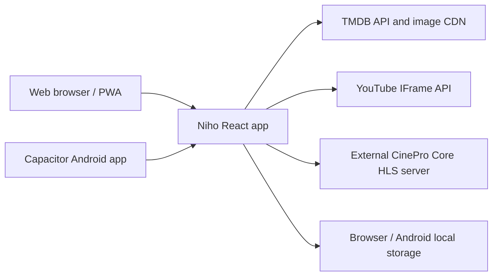

# Niho

Niho is a mobile-first film and TV discovery interface built with React and
TypeScript. It provides TMDB-powered discovery, title details, search,
profiles, My List, Continue Watching, trailers, and optional CinePro HLS
playback for movies and TV episodes.

Niho is a frontend application. It does not contain a media backend, scraper,
database, user account service, or authentication server. Metadata comes from
TMDB, trailers are embedded from YouTube, and direct playback is delegated to
an externally running [CinePro Core](https://github.com/numan259/cinepro)
service.

## Niho + CinePro

Niho and CinePro are separate projects designed to work together:

- [Niho](https://github.com/numan259/niho) is the user-facing discovery and
  playback interface.
- [CinePro](https://github.com/numan259/cinepro) is the streaming backend that
  resolves media and serves HLS playlists, audio tracks, subtitle tracks, and
  segments.

Niho needs CinePro when users want to watch full movies or TV episodes. Niho
handles the catalog experience and player controls, while CinePro handles the
server-side stream preparation and delivery. Running both projects gives
self-hosters a complete setup instead of a catalog-only application. CinePro
can remain on a private network or VPN, and Niho connects to its configured
Core URL without requiring the media service to be exposed publicly.

## Features

- Discovery rows for trending, popular, top-rated, and genre titles
- Movie and TV title pages with cast, ratings, seasons, episodes, and recommendations
- TMDB search with infinite scrolling
- Profiles, Kids profile filtering, My List, likes, and Continue Watching
- Official YouTube trailer playback
- Optional CinePro HLS playback for movies and TV episodes
- Movie and episode downloads with offline playback, progress, cancel/retry, and deletion
- HLS quality, audio-track, subtitle-track, seek, volume, and fullscreen controls
- Tap to show or hide controls, even while paused; a single central play/pause button
- Double-tap or double-click the left/right side to skip back/forward 10 seconds
- Double-tap or double-click the middle third to toggle play/pause
- Hold the picture for temporary 2× playback; release to restore the previous speed
- Screen lock prevents accidental touches, with a two-step unlock
- In-player episode picker, next-season continuation, and optional autoplay countdown
- Saved audio/subtitle language, subtitle size, and autoplay preferences
- Progress saved on pause, seeking, leaving playback, and app backgrounding
- Automatic stream recovery with buffering feedback and a retry button
- White, shadowed subtitles positioned inside the picture and above visible controls
- Artwork fades, loading skeletons, and reduced-motion support
- Android landscape fullscreen with hidden system bars and Back-button exit
- Responsive web app and Capacitor Android shell
- PWA installability for production web builds
- Unit tests, Playwright smoke tests, and Oxlint checks

## Screenshots

Screenshots are not currently included. Add project screenshots here before
publishing a public release, for example:

```text
docs/screenshots/home.png
docs/screenshots/title.png
docs/screenshots/player.png
```

## Architecture



The `src/providers/tmdb.ts` module calls TMDB for metadata and images. The
`src/providers/cinepro.ts` module constructs CinePro stream URLs. The player
uses hls.js for browsers without native HLS and uses native HLS when hls.js is
unavailable but the browser supports HLS.

The [CinePro service](https://github.com/numan259/cinepro) is external to this
repository. Its expected endpoints are:

```text
http://<cinepro-host>:3000/streams/movie/{tmdbId}/master.m3u8
http://<cinepro-host>:3000/streams/tv/{tmdbId}/{season}/{episode}/master.m3u8
```

Set `VITE_CINEPRO_URL` to your CinePro host; it defaults to
`http://localhost:3000`. See [Configuration](docs/CONFIGURATION.md).

## Prerequisites

### Web development

- Node.js 24 and npm, matching CI
- Git
- A TMDB account and API key or read access token
- A reachable CinePro Core instance if direct playback is required

Windows, macOS, and Linux are suitable for web development. A modern
dual-core computer with at least 4 GB RAM is recommended; 8 GB RAM is
recommended when running Android tooling and browsers together.

### Android development

- Android Studio or Android SDK command-line tools
- Android SDK platform/build tools compatible with the Capacitor project
- Java/JDK 21 (Android Studio's bundled JBR can be used)
- A connected Android device with USB debugging enabled, or an emulator

Android builds are optional. The web application does not require Android
Studio.

## Installation

```bash
git clone <your-fork-or-repository-url>
cd netflix
npm ci
```

Create local configuration from the safe template:

```bash
cp .env.example .env.local
```

On Windows PowerShell:

```powershell
Copy-Item .env.example .env.local
```

Edit `.env.local` and set `VITE_TMDB_API_KEY` to your own TMDB credential.
Never commit `.env` or `.env.local`.

Start the web app:

```bash
npm run dev
```

Open <http://localhost:5173>. Stop the development server with `Ctrl+C`.

The project has no database migration or database setup step. Profiles,
library state, and progress are stored locally on the device.

## Configuration

The complete environment-variable reference is in
[docs/CONFIGURATION.md](docs/CONFIGURATION.md).

Configure these environment variables in `.env.local`:

```env
VITE_TMDB_API_KEY=your_tmdb_api_key_here
VITE_CINEPRO_URL=http://localhost:3000
```

Vite embeds `VITE_*` values into browser and Android builds. Treat the key as
public/read-only application configuration, not as a server-side secret.

`VITE_CINEPRO_URL` must be reachable from the device playing the video.
On a phone, `localhost` refers to the phone itself; use your server's LAN/VPN
address or USB port forwarding as described below. Restart Vite after changing
configuration and rebuild the APK to apply changes to Android.

## Usage

1. Clone and configure [CinePro](https://github.com/numan259/cinepro) if full
   movie or TV playback is needed, and start its Core server.
2. Start Niho with `npm run dev`.
3. Open the local web URL.
4. Choose or create a local profile.
5. Browse rows or search for a title.
6. Open a movie or select a TV episode.
7. Use the player controls for playback, quality, audio, subtitles, seeking,
   volume, and fullscreen.

### Player gestures and subtitles

For CinePro movies and episodes, tap the picture to show or hide all controls,
even while paused. Tapping the picture does not change playback; use the central
play/pause button for that. Controls also hide automatically
after three seconds while playing and stay visible while a settings menu is open.
Double-tap (or double-click) the left/right side of the picture to seek back/forward
10 seconds. Double-tap the middle third to toggle play/pause. The visible central
play/pause button also works with a single tap.

While playing, hold the picture for about half a second to play at **2× speed**.
Release to restore the previous speed. Sliding before the hold activates cancels
it; releasing a hold does not toggle the controls or pause the video.

Use **Lock controls** to prevent accidental gestures. Tap the picture to reveal
**Unlock controls**, then tap that button and **Tap again to unlock** to unlock.
Open **Playback settings** to save audio/subtitle language, subtitle size, and
autoplay preferences on this device. A missing preferred language falls back to
the stream's default audio or no subtitles.

For TV, **Episodes** opens a season and episode picker without leaving the player.
At the end of an episode, autoplay offers a cancellable 10-second countdown and
continues into the next available season. Disable autoplay in Playback settings
to choose when to continue. The countdown pauses while the app is in the
background or the player is locked or showing a settings/episode sheet.

Watch progress is saved every five seconds during playback and immediately on
pause, seeking, leaving the player, and moving the app into the background.
Interrupted HLS streams attempt recovery; if recovery fails, **Retry playback**
reloads the stream at the last position.

Subtitles use centered white text with a dark shadow, preserve line breaks and
basic formatting, and scale with the picture. They remain inside the video image
when it has black bars and move above the timeline when controls appear.
Choose a language or **Off** from the subtitle menu.

On Android, fullscreen requests landscape orientation and hides the system bars.
Exit fullscreen or press the Android Back button to release the orientation lock
and restore the bars. Web fullscreen requests landscape where the browser supports
it. Browsers using their own native fullscreen video player control caption layout
and rotation themselves. YouTube trailers use YouTube's embedded controls.

With the player focused, keyboard shortcuts are Space/K (play/pause), Left/J and
Right/L (seek 10 seconds), M (mute), and F (fullscreen).

### Downloads and offline viewing

Open a movie and tap **Download movie**, or use **Download episode** under an
episode. Open the **Downloads** tab or **My Niho → Downloads** to follow progress, cancel, retry, delete a
saved video, or choose **Watch offline**. Downloads are listed per profile and
stored on this device. Watch progress is saved as usual.

Downloaded TV episodes are grouped by show. Tap a show to see its saved episodes
organized by season, then tap an episode to play it offline. Movies remain directly
playable from the main Downloads screen. Each show displays its downloaded episode
count and total size; unfinished downloads can be managed inside the same list.

Add multiple movies or episodes to the queue. Niho downloads them in order and
starts the next automatically, fetching up to three video resources concurrently
for the active title. Queue positions are shown in Downloads; queued items can
be cancelled or removed, and failed items can be added again with Retry.

On Android, a native foreground service continues the queue when the app is
backgrounded or the screen is off. The first download requests notification
permission on Android 13+ so progress and cancellation are available from the
notification. Denying notifications does not prevent the foreground service.
Downloads also provides notification and battery-settings buttons. If the phone
restricts Niho, allow unrestricted background battery usage there. Android may
still stop transfers after a force-stop, reboot, or its background-service time
limit; reopening Niho resumes queued work and already-saved native segments.

In a web browser, keep the app open while downloading. The queue survives reloads;
an interrupted active web download is marked for Retry while waiting entries
continue automatically. Retries start that video again. The downloader chooses
the best available variant up to 720p (or the
lowest variant if all are larger), the preferred/default audio, and matching
subtitles from Playback settings. The saved quality and languages appear on the
download card. Embedded audio and captions remain part of the video.

Completed downloads play without TMDB or CinePro requests, including after closing
and reopening the Android app. Production web builds also cache every app route
and the player runtime for offline startup; visit the app online first and allow
its service worker to finish installing. The Vite development server does not
provide an offline app shell.

Downloads require a completed HLS VOD playlist and a browser with Media Source
support (including the Android app). Live/incomplete playlists, DRM, certain
advanced HLS extensions, and individual resources over 128 MB are rejected with
an explanation. Storage availability depends on the device/browser quota. Clearing
app/site data removes downloads; browsers may also remove non-persistent storage.
YouTube trailers are not downloaded.

### Android installation

For Android:

```bash
npm run android:apk
```

This builds the web app, synchronizes Capacitor assets, and produces a debug
APK at `android/app/build/outputs/apk/debug/app-debug.apk`. Install it with
Android tooling, for example:

```bash
adb install -r android/app/build/outputs/apk/debug/app-debug.apk
```

The `-r` option updates an existing installation while preserving its app data.
If Java 21 is not your default on Windows, use Android Studio's JBR for the build:

```powershell
$env:JAVA_HOME = 'C:\Program Files\Android\Android Studio\jbr'
npm run android:apk
```

The Android shell bundles the web app. The phone must be able to reach both
TMDB and the configured CinePro host. USB `adb reverse` can be used when
CinePro is intentionally running on the development computer:

```bash
adb reverse tcp:3000 tcp:3000
```

## Development

```text
src/providers/     TMDB and CinePro integrations
src/catalog/       Rows, page composition, and query hooks
src/routes/        Application routes and screens
src/ui/            Reusable UI, layouts, and video players
src/state/         Local profile and library persistence
e2e/               Playwright tests with mocked external services
android/           Capacitor Android project
scripts/           Build helpers
```

Useful commands:

```bash
npm run dev
npm run build
npm run lint
npm run typecheck
npm test
npm run test:e2e
npm run test:offline
npx playwright test e2e/player.spec.ts
npm run preview
npm run android:apk
```

The development server listens on port 5173 by default. Playwright starts an
isolated test server on port 5174. Vite preview uses its standard preview port
unless overridden.

The focused player suite checks touch/mouse gestures, hold-to-speed, screen lock,
saved preferences, episode selection, fullscreen, and subtitle layout in portrait
and landscape using local media fixtures. Unit tests also cover progress saving,
autoplay, next-season selection, and bounded stream recovery. Tests do not require
a CinePro server. Real stream delivery and physical-device rotation should also
be checked on your own setup.

`npm run test:offline` builds and serves the production app on port 5175 and
tests downloads using a small generated video fixture. It verifies a cold reload
with networking disabled, playback, subtitles, seeking, deletion, retry,
cancellation, interrupted downloads, storage quota failures, queue progression,
and bounded parallel transfers. Android's `DownloadServiceTest` instrumentation
test checks native queue progression with the activity backgrounded and screen off.

## Troubleshooting

See [docs/TROUBLESHOOTING.md](docs/TROUBLESHOOTING.md) for missing-key,
TMDB, CORS, network, Android cleartext, Tailscale, and HLS playback guidance.

Common first checks:

- Confirm `.env.local` exists and contains a non-placeholder TMDB key.
- Restart Vite after changing environment files.
- Confirm CinePro is reachable from the browser or phone.
- Confirm the stream URL uses the configured CinePro host and the required
  movie or TV path.
- Check browser DevTools for CORS, mixed-content, and hls.js errors.

## Security

- Do not commit `.env`, `.env.local`, or real credentials.
- `VITE_*` values are visible in built web and Android assets.
- Do not expose CinePro or development servers directly to the public
  internet without authentication, access controls, and HTTPS.
- Prefer a private network or VPN such as Tailscale for development.
- Review the security guidance in [SECURITY.md](SECURITY.md).

## Contributing

Read [CONTRIBUTING.md](CONTRIBUTING.md) before opening a pull request.

## Licensing and acknowledgements

This repository currently has no project `LICENSE` file. Add a license before
making a public release if you want others to have explicit permission to use,
modify, and redistribute the project.

Niho uses independently written application code plus third-party packages
listed in `package.json` and `package-lock.json`, including React, Vite,
React Router, TanStack Query, Zustand, hls.js, Capacitor, Vitest, Playwright,
Oxlint, and the Bricolage Grotesque font package. Preserve each dependency's
license and notices when redistributing.

Niho uses the TMDB API and imagery, YouTube for embedded trailers, and
JustWatch availability data exposed through TMDB. Niho is not endorsed or
certified by TMDB, YouTube, JustWatch, or any streaming service.
