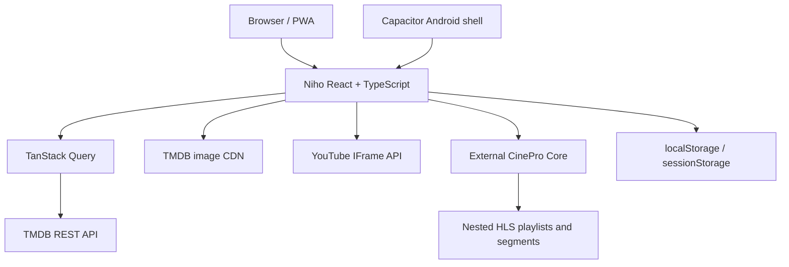

# Architecture

## Repository components

- `src/routes`: route-level screens.
- `src/catalog`: row definitions and query hooks.
- `src/providers/tmdb.ts`: TMDB requests and pure response mapping.
- `src/providers/cinepro.ts`: CinePro stream URL construction.
- `src/ui/player`: YouTube and direct HLS/MP4 playback.
- `src/state`: local profiles, library, likes, and progress.
- `android`: generated Capacitor Android project.
- `e2e`: deterministic browser tests with network mocks.

## External boundaries

Niho has no repository-owned backend or database. TMDB supplies metadata and
images. YouTube supplies embedded trailers. The separate
[CinePro project](https://github.com/numan259/cinepro) supplies direct HLS
playlists, audio tracks, subtitle tracks, and segments. Local storage supplies
device-only user state.

Niho is useful without CinePro for discovery, metadata, trailers, and
watch-provider information. CinePro is required for the full-playback
experience because it is the component that prepares and delivers the HLS
media stream.

## Routes and ports

- Vite development server: `http://localhost:5173`
- Playwright server: `http://127.0.0.1:5174`
- CinePro contract: port `3000`
- Movie HLS: `/streams/movie/{tmdbId}/master.m3u8`
- TV HLS: `/streams/tv/{tmdbId}/{season}/{episode}/master.m3u8`

The CinePro host comes from `VITE_CINEPRO_URL`, defaulting to
`http://localhost:3000`; `src/providers/cinepro.ts` constructs the stream URLs.

The direct-stream player uses a custom subtitle overlay fed by active browser
text-track cues. It positions captions within the displayed picture and above
visible playback controls. Android fullscreen uses Capacitor Screen Orientation
and System Bars; browser fullscreen uses the available web APIs.

Playback preferences persist in the `niho.playback` local store and apply across
profiles on the same device. Watch progress remains part of each profile's
library. The progress hook saves on media and page lifecycle events, including
Capacitor app backgrounding, and captures the media node before React unmounts it.
The player bounds HLS recovery attempts and detects a stalled playback clock.
Episode navigation uses TMDB season metadata, with an optional end-of-episode
countdown and a season/episode picker inside the player.

## Offline downloads

`src/offline` stores download metadata and individual HLS resources as IndexedDB
Blobs, separate from the app-shell service-worker cache. It reduces a master
playlist to one video rendition and matching audio/subtitles, rewrites all
resource references to local identifiers, then marks a download ready only after
every required file has been saved. The custom hls.js loader serves these local
resources, including byte ranges, and never falls back to a network URL.

The Downloads route and offline player use saved metadata without TMDB queries.
One foreground download runs at a time; failure/cancellation removes partial
files. A new app session identifies interrupted jobs and clears their data before
offering retry. Download deletion removes files and metadata in one transaction.
Profile IDs scope access to downloads; the storage total includes all profiles.

`scripts/offline-shell.mjs` generates a versioned service worker after each web
build, precaching all hashed assets including lazy routes and the HLS runtime.
The Android shell already bundles these assets. Downloads do not use the service
worker and survive app-shell cache upgrades.
