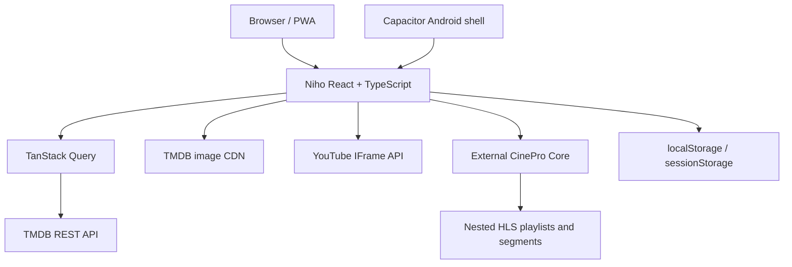

# Architecture

## Repository components

- `src/routes`: route-level screens.
- `src/catalog`: row definitions and query hooks.
- `src/providers/tmdb.ts`: TMDB requests and pure response mapping.
- `src/providers/cinepro.ts`: CinePro stream URL construction.
- `src/ui/player`: YouTube and direct HLS/MP4 playback.
- `src/state`: local profiles, library, likes, and progress.
- `android`: generated Capacitor Android project.
- `e2e`: deterministic browser tests with network mocks.

## External boundaries

Niho has no repository-owned backend or database. TMDB supplies metadata and
images. YouTube supplies embedded trailers. The separate
[CinePro project](https://github.com/numan259/cinepro) supplies direct HLS
playlists, audio tracks, subtitle tracks, and segments. Local storage supplies
device-only user state.

Niho is useful without CinePro for discovery, metadata, trailers, and
watch-provider information. CinePro is required for the full-playback
experience because it is the component that prepares and delivers the HLS
media stream.

## Routes and ports

- Vite development server: `http://localhost:5173`
- Playwright server: `http://127.0.0.1:5174`
- CinePro contract: port `3000`
- Movie HLS: `/streams/movie/{tmdbId}/master.m3u8`
- TV HLS: `/streams/tv/{tmdbId}/{season}/{episode}/master.m3u8`

The CinePro host comes from `VITE_CINEPRO_URL`, defaulting to
`http://localhost:3000`; `src/providers/cinepro.ts` constructs the stream URLs.

The direct-stream player uses a custom subtitle overlay fed by active browser
text-track cues. It positions captions within the displayed picture and above
visible playback controls. Android fullscreen uses Capacitor Screen Orientation
and System Bars; browser fullscreen uses the available web APIs.
