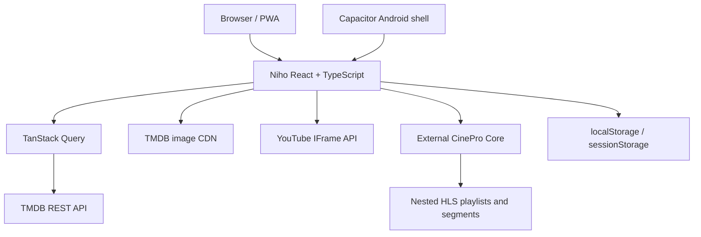

# Architecture

## Repository components

- `src/routes`: route-level screens.
- `src/catalog`: row definitions and query hooks.
- `src/providers/tmdb.ts`: TMDB requests and pure response mapping.
- `src/providers/cinepro.ts`: CinePro stream URL construction.
- `src/ui/player`: YouTube and direct HLS/MP4 playback.
- `src/state`: local profiles, library, likes, and progress.
- `android`: generated Capacitor Android project.
- `e2e`: deterministic browser tests with network mocks.

## External boundaries

Niho has no repository-owned backend or database. TMDB supplies metadata and
images. YouTube supplies embedded trailers. CinePro supplies direct HLS
playlists and segments. Local storage supplies device-only user state.

## Routes and ports

- Vite development server: `http://localhost:5173`
- Playwright server: `http://127.0.0.1:5174`
- CinePro contract: port `3000`
- Movie HLS: `/streams/movie/{tmdbId}/master.m3u8`
- TV HLS: `/streams/tv/{tmdbId}/{season}/{episode}/master.m3u8`

The current CinePro host is a hardcoded deployment value in
`src/providers/cinepro.ts`. It should be made configurable before broad
self-hosting.

